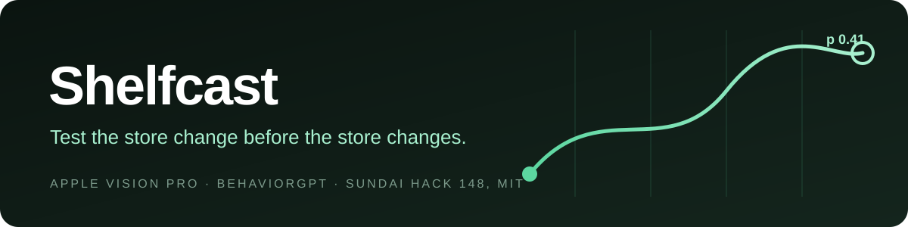
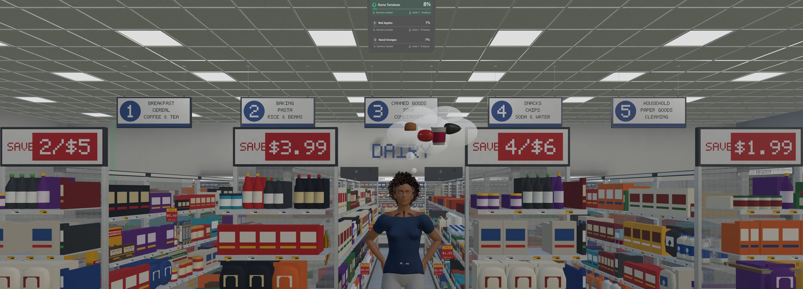
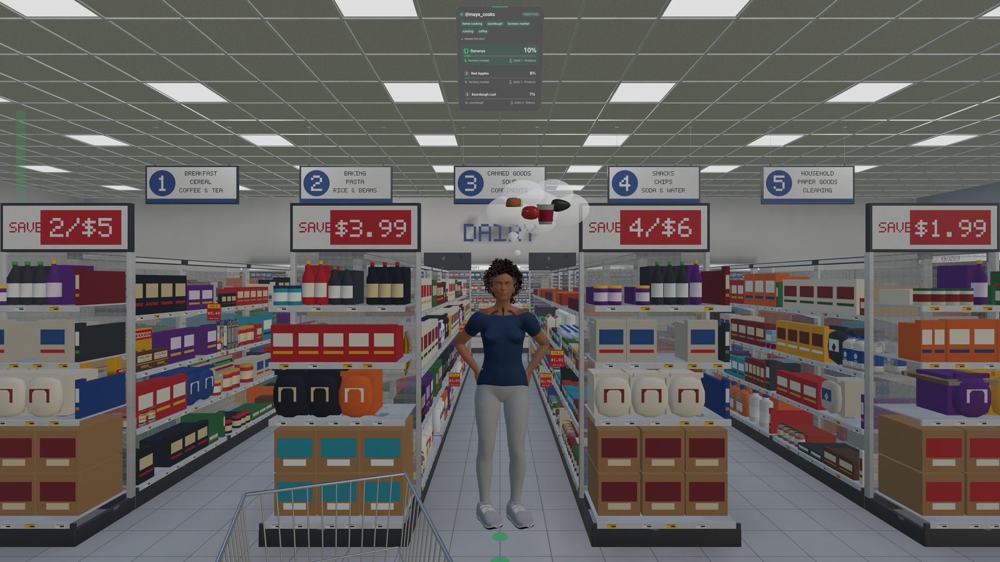
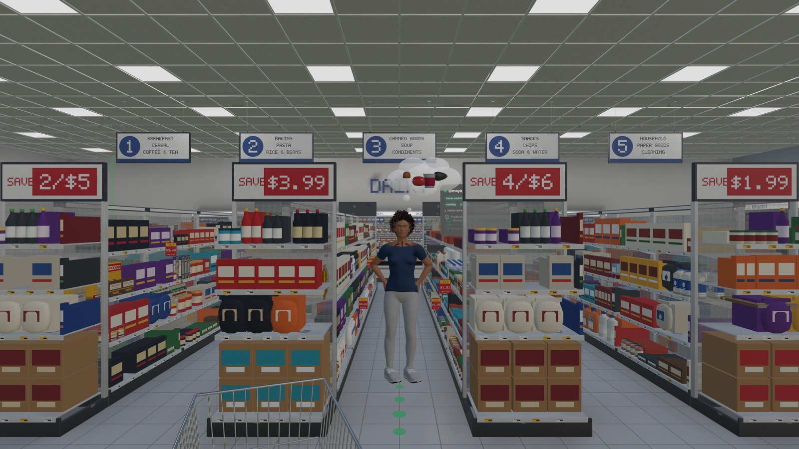
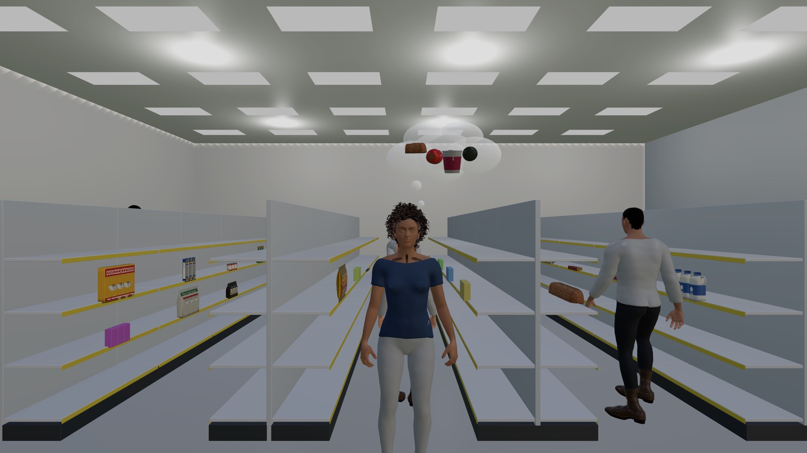
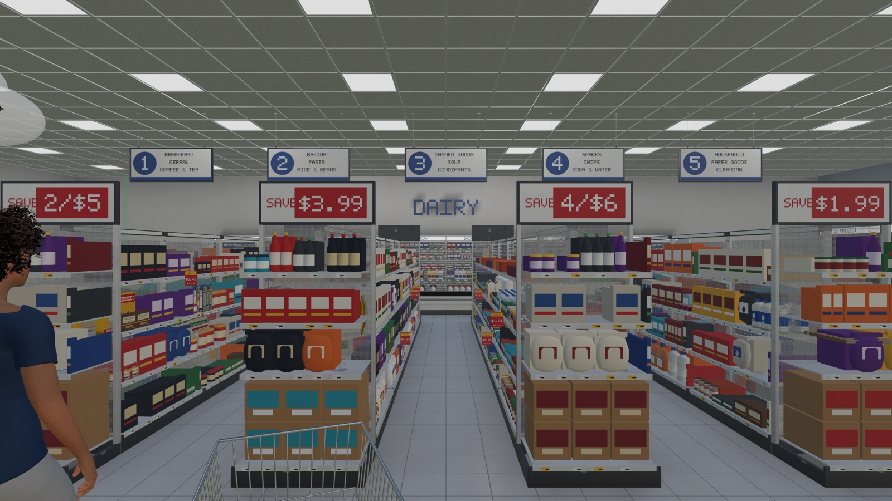
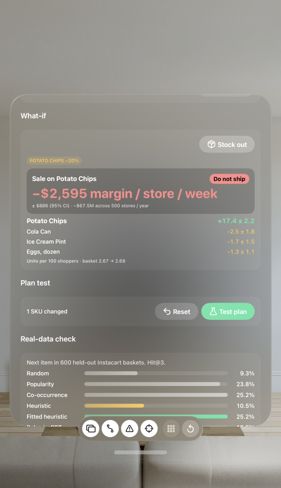
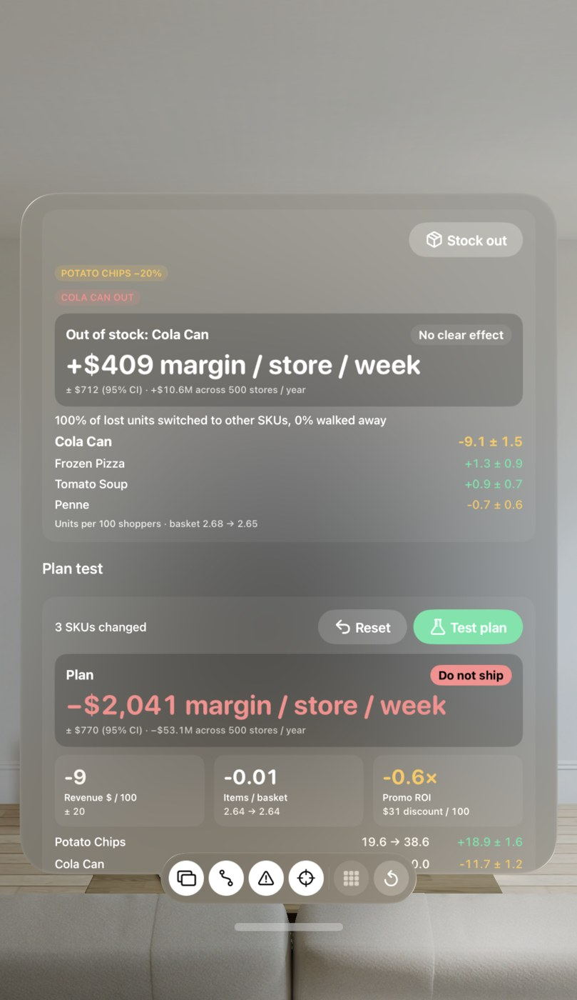
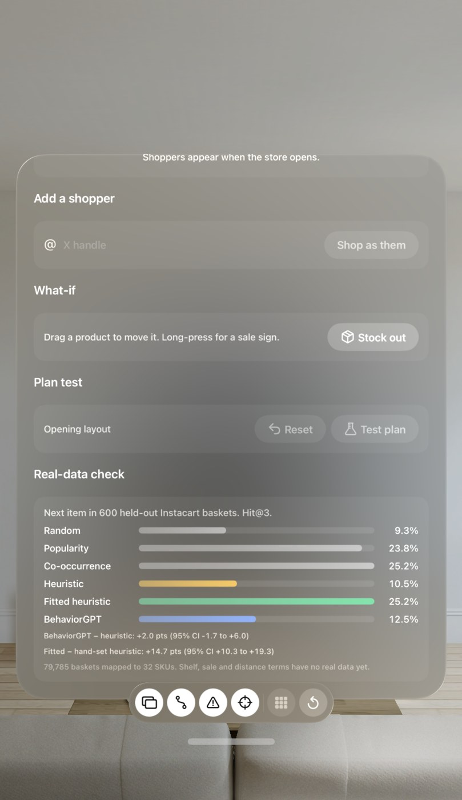

<p align="center"></p>

<p align="center">


</p>

<p align="center"></p>

A store change (an endcap move, a sale sign, an aisle swap) costs labor, shelf downtime and weeks of sales data
before anyone knows whether it worked. Shelfcast runs the change first, in a 1:1 supermarket on Apple Vision
Pro, with shoppers driven by a large behavioral model. Move a product, watch shoppers re-decide, read the margin
per store per week with a confidence interval, and ship or kill the plan.

## The numbers

| Metric | Value | Source |
|---|---|---|
| Real baskets checked | 79,785 Instacart baskets, 600 held-out test prefixes | `demo/validation.json` |
| Next-item Hit@3, fitted model | 25.2% (random 9.3%) | `tools/validate_instacart.py` |
| Fitted vs hand-set heuristic | +14.7 pts Hit@3, 95% CI +10.3 to +19.3 | `demo/validation.json` |
| Simulated shoppers per test | 50 shoppers × 20 paired replicates | `Predict/Experiment.swift` |
| Sale sign on towels | +18.2 ± 2.2 carts per 100 shoppers | `demo/results.json` |
| Checkout anomaly AUROC | 0.63 | `BehaviorAisleTests/ExperimentTests.swift` |

## Product

<table>
<tr>
<td width="50%"><br><b>A store at full scale.</b> RealityHD grocery scene, numbered aisles, shelf tags, HumanHD shoppers.</td>
<td width="50%"><br><b>Intent on the floor.</b> Predicted next items float overhead; the path shows where the shopper goes next.</td>
</tr>
<tr>
<td><br><b>Shop as anyone.</b> Import an X profile. Body, tastes and wishlist become a shopper.</td>
<td><br><b>Predict, walk, pick, repeat.</b> Each pick is appended to history and the model is called again.</td>
</tr>
</table>

## Plan test

Drag a product, long-press for a sale sign, or stock an item out. Every shopper re-queries and the paired
simulation reports the effect in dollars.

<table>
<tr>
<td width="25%"><br><b>Move.</b> Ground coffee to a new slot: +$196 margin / store / week.</td>
<td width="25%"><br><b>Sale.</b> Chips at 20% off: −$2,595 / store / week. Do not ship.</td>
<td width="25%"><br><b>Plan.</b> Three SKUs changed, revenue, basket size and promo ROI together.</td>
<td width="25%"><br><b>Real-data check.</b> Hit@3 on held-out Instacart baskets, shown in the app.</td>
</tr>
</table>

## How it works

```
Shopper history ──▶ BehaviorGPT (Unbox AI, via proxy) ──▶ top-3 next actions with p
      ▲                                                          │
      └──── append event ◀── walk to shelf, view / add / checkout ◀┘
```

| Layer | Code |
|---|---|
| Store, gondolas, props | `Store/StoreBuilder.swift` |
| Shopper loop | `Model/AppModel.swift`, `Shopper/ShopperAgent.swift` |
| Predictors (BehaviorGPT, replay, heuristic) | `Predict/` |
| Arcs, fork ghosts, heatmap, intent | `Viz/` |
| Paired what-if experiment | `Predict/Experiment.swift` |
| Proxy (keys stay server-side) | `proxy/worker.js`, `proxy/server.mjs` |

Prediction sources fall back in order: live BehaviorGPT, replay log, local heuristic. Live results append to
`Documents/predictions.jsonl` and replay offline.

## Run

```sh
xcodegen
open BehaviorAisle.xcodeproj        # run on Apple Vision Pro or the visionOS simulator
node proxy/server.mjs               # simulator: app defaults to http://127.0.0.1:8787/predict
```

Device: deploy `proxy/worker.js` with `UNBOX_API_KEY`, `UNBOX_ENDPOINT`, `APP_TOKEN` as secrets, then paste the
URL and token in the app. Local key file: `~/.config/behavioraisle/env` (`UNBOXAI_API_KEY`). BehaviorGPT catalog
`cat_aad381c2766331790c3efaa8` (32 SKUs, uploaded by `tools/embed_catalog.py`).

## X profile import

Control window, X profile, Import profile. The proxy fetches the profile (`GET /twitter?handle=`, X API v2) and
classifies it (`POST /classify`, OpenRouter, JSON schema, default `anthropic/claude-sonnet-5.5`). Body traits come
from the profile photo and map to a HumanHD `HumanSpec` (`Profile/HumanTraitsMapper.swift`); grocery affinity and the
wishlist come from bio and posts. The shopper joins the store with a thought cloud of wishlist products overhead.
Add `X_BEARER_TOKEN` and `OPENROUTER_API_KEY` (optional `OPENROUTER_MODEL`) to `~/.config/behavioraisle/env` or the
Worker secrets. Without OpenRouter the app falls back to a keyword classifier and a seeded random human.

## Documents

| File | Contents |
|---|---|
| [Promo](demo/BehaviorAisle-Promo.pdf) | Product one-pager |
| [Paper](demo/BehaviorAisle-Paper.pdf) | Method, experiments, ablations |
| [Demo plan](demo/BehaviorAisle-Demo-Plan.pdf) | Stage demo script |
| [Intent demo](demo/BehaviorAisle-Intent-Demo.pdf) | Intent layer walkthrough |
| [X profile demo](demo/BehaviorAisle-XProfile-Demo.pdf) | Profile import flow |
| [PRD](PRD.md) | Requirements and prediction contract |

<p align="center"><sub>Dicyanin Labs · <code>org.dicyaninlabs.behavioraisle</code></sub></p>
